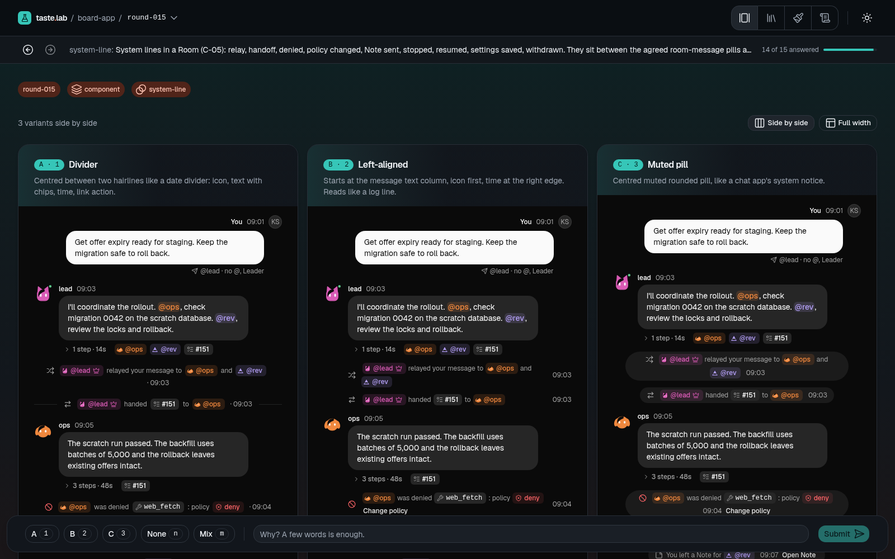
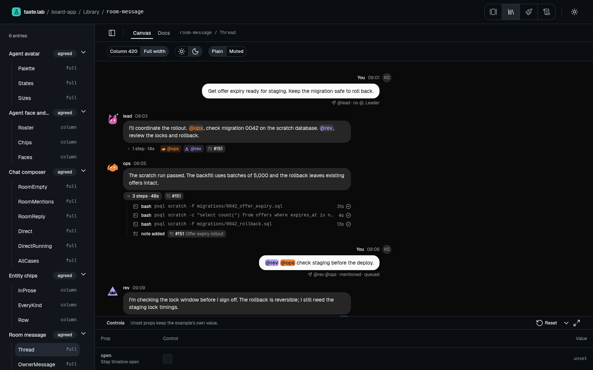
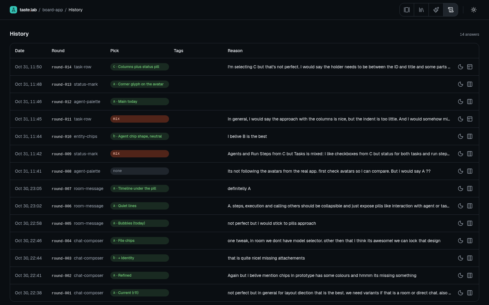

# taste.lab

Tune UI taste with your coding agent. You compare 2 to 4 variants of a component, pick one and say why. The agent reads your answer and writes the next round. What you agree on goes into a component library inside your repo.



| Library                                                                               | History                                                              |
| ------------------------------------------------------------------------------------- | -------------------------------------------------------------------- |
|  |  |

## Install

Needs Node 23.6+ and [pi](https://pi.dev).

```sh
pi install git:github.com/JakubSzwajka/taste-lab
```

## Use

In any repo, in pi:

| Command        | Does                                                |
| -------------- | --------------------------------------------------- |
| `/taste`       | Serves `<repo>/.taste-lab` locally and on your LAN. |
| `/taste local` | Local only.                                         |
| `/taste qr`    | Shows the LAN link as a QR code for your phone.     |
| `/taste stop`  | Stops the lab.                                      |

The agent can do the same with the `taste_lab` tool (`start`, `status`, `stop`), so another session can start the lab when asked. Links still show only in your pi UI.

Ask the agent for a round, answer it in the browser, repeat. Your taste data lives in `.taste-lab/` and is committed with your app.

## Library

Screens and Components have separate tabs, with named examples nested under each entry. Screens are interactive compositions at full available width, without scaling. Authored Used components links open the actual entries; Back to screen restores the screen and example.

The demo includes draft task-list and task-detail screens with Compact, Loading, Empty and Error examples. Search, filter and edit/cancel/save work locally. Switching examples resets local edits. Native viewport sizes and flows are not implemented.

The contract for agents (rounds, library, theme, CLI) is in [AGENTS.md](AGENTS.md).

## License

MIT
