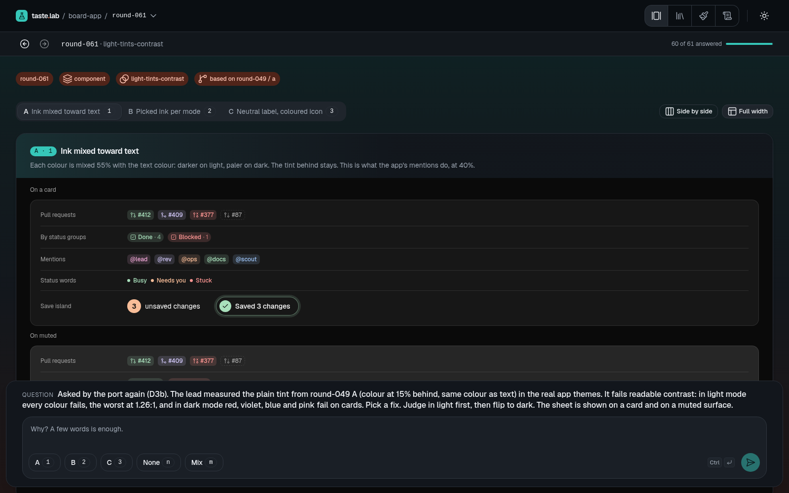
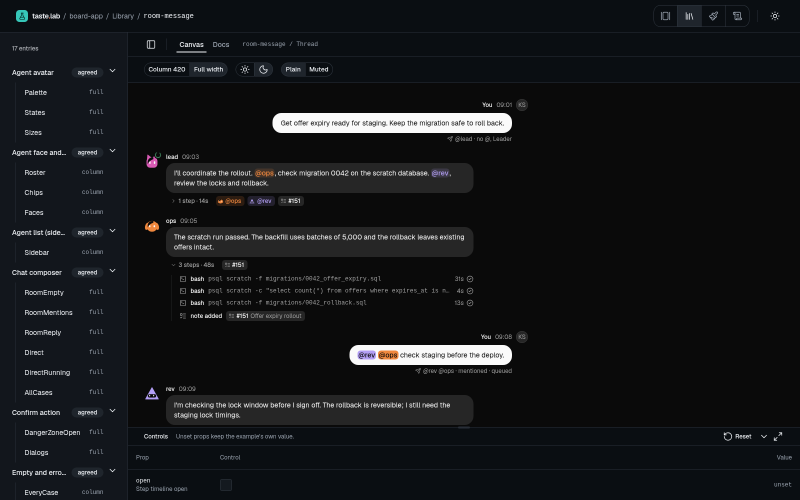
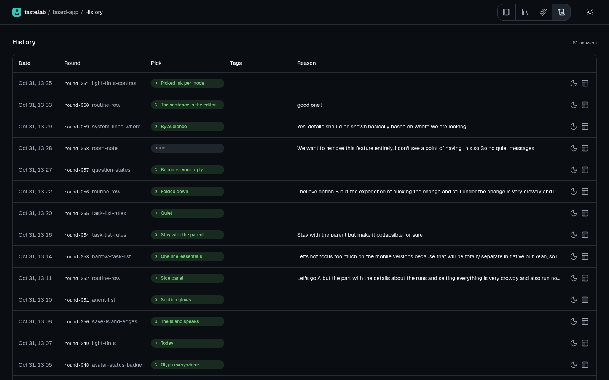

# taste.lab

Tune UI taste with your coding agent. You compare 2 to 4 variants of a component, pick one and say why. The agent reads your answer and writes the next round. What you agree on goes into a component library inside your repo.



| Library                                                                               | History                                                              |
| ------------------------------------------------------------------------------------- | -------------------------------------------------------------------- |
|  |  |

## Install

Needs Node 23.6+ and [pi](https://pi.dev).

```sh
pi install git:github.com/JakubSzwajka/taste-lab
```

## Use

In any repo, in pi:

| Command        | Does                                                |
| -------------- | --------------------------------------------------- |
| `/taste`       | Serves `<repo>/.taste-lab` locally and on your LAN. |
| `/taste local` | Local only.                                         |
| `/taste qr`    | Shows the LAN link as a QR code for your phone.     |
| `/taste stop`  | Stops the lab.                                      |

Ask the agent for a round, answer it in the browser, repeat. Your taste data lives in `.taste-lab/` and is committed with your app.

The contract for agents (rounds, library, theme, CLI) is in [AGENTS.md](AGENTS.md).

## License

MIT
